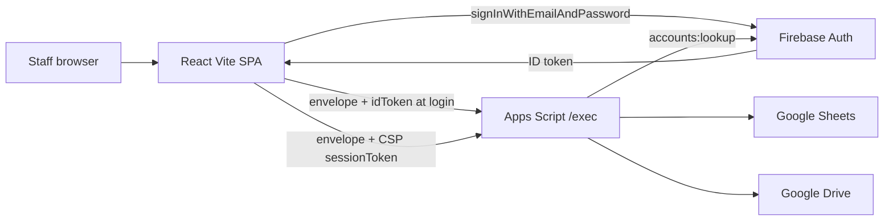
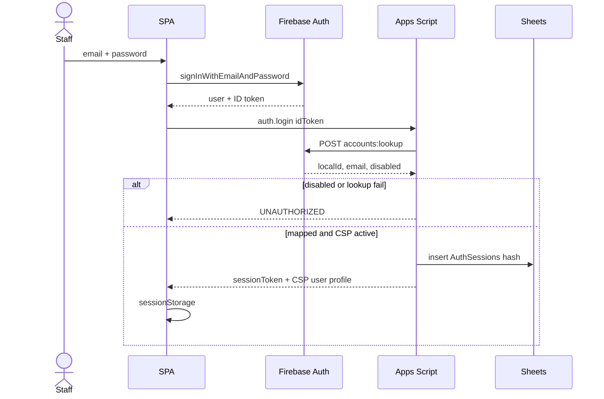
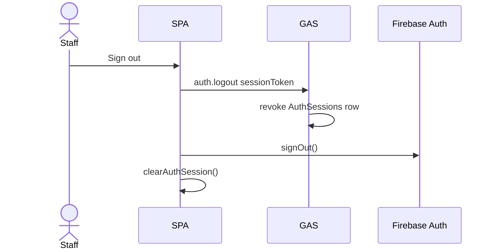
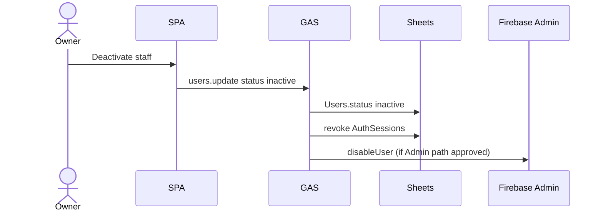
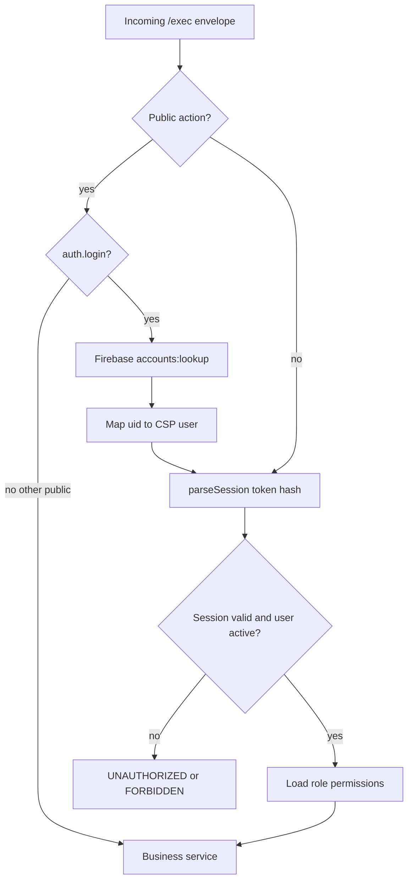

# External Authentication Architecture V1

**Status:** Research only. Do not implement, merge, deploy, or migrate until the owner explicitly approves.

**Date:** 21 November 2026 (Asia/Kuala Lumpur)

**Scope:** Technical feasibility of a dedicated external identity provider for CSP Inventory & Sales System, preserving the locked SPA + Apps Script + Google Sheets/Drive architecture.

**Related:** [PR #131](https://github.com/zall266/CSP_Inventory-Sales-System/pull/131) (Authentication & Staff Management V1, **not merged**, **not deployed**). Inspected at commit `681848a` on branch `cursor/auth-staff-management-v1-d9ac`.

---

## 1. Executive summary

PR #131 proved that CSP can enforce **backend authorization** inside Apps Script: the router overwrites `actorUserId` from a server-side session, strips client-supplied role fields, and loads permissions from Sheets. That authorization model should be kept.

PR #131 also proved that Apps Script **cannot** host production-grade password hashing. PBKDF2-HMAC-SHA256 at 12,000 iterations is **not OWASP-compliant** (OWASP recommends 600,000). Session tokens live in `sessionStorage` because `ContentService` cannot set HttpOnly cookies for GitHub Pages. Those two residuals are architecture limits, not incomplete coding.

An external identity provider can take ownership of **passwords, MFA, lockout, and password reset**. Apps Script can then verify a provider credential and map it to the existing CSP user, role, and permission model.

**Recommended target**

| Decision | Choice |
| --- | --- |
| Provider | **Firebase Authentication** (email/password). Upgrade to **Firebase Authentication with Identity Platform** when MFA is required. |
| Integration | **Option C — hybrid.** Provider authenticates. Apps Script verifies the ID token **once at login** via the official REST lookup, then mints a **CSP server-side session** (reuse PR #131). |
| Not recommended as-is | Passing a provider JWT on every business request (UrlFetch quota and provider-outage blast radius). Local RS256 JWT verification inside Apps Script (no native public-key verify API). |
| Architecture change | **Not required** for the recommended design. HttpOnly cookies for the GAS API **are** an architecture change and are **not** claimed here. |

**Why Firebase over Auth0, Clerk, and Supabase Auth**

- Official REST verification that Apps Script can call: `POST https://identitytoolkit.googleapis.com/v1/accounts:lookup?key=API_KEY` with `{ "idToken": "..." }`. This is documented Firebase Auth REST, not an invented endpoint.
- Password hashing is Google's modified **scrypt**, not Apps Script PBKDF2.
- Email/password, password reset, disable-user, and React SDK are first-class.
- Cost at 5–100 staff is **USD 0 / month** on current official pricing (well under 50,000 MAU). TOTP MFA after Identity Platform upgrade remains inside the 50,000 MAU free band.
- Google already operates Sheets, Drive, and Apps Script for this system. Firebase Auth does **not** require migrating business data off Sheets.

**Honest limits (do not oversell)**

1. Apps Script `Utilities` can **sign** RSA-SHA256 with a **private** key. It does **not** document a public-key **verify** method. Local RS256 JWT verification is therefore **not a supported native path**. Shipping `jsrsasign` or similar into GAS is a supply-chain and maintenance risk and is **not** recommended.
2. GitHub Pages (DEV) and any future CSP subdomain are **cross-origin** from `script.google.com`. No evaluated provider can attach an HttpOnly cookie that the Apps Script `/exec` endpoint will receive. `sessionStorage` is **not** equivalent to HttpOnly cookies. XSS remains a residual for the CSP session token.
3. Firebase Authentication processes data **exclusively in US data centres**. Malaysia data residency for identity records is **not** available. This is an owner decision, not a coding issue.
4. Verifying a provider token on **every** POS/inventory call would consume Apps Script **URL Fetch** quota (20,000/day consumer, 100,000/day Google Workspace). Hybrid CSP sessions after one verified login are required for this runtime.

**Do not implement until the owner answers the open questions in section 16.**

---

## 2. Current architecture assessment

### 2.1 Locked application architecture (unchanged)

```text
React + Vite SPA (GitHub Pages DEV)
    → adapters / postIdentityAction
    → Apps Script /exec  (doPost, envelope { v:1, requestId, action, payload })
    → Controller → Service → Repository
    → Google Sheets (system of record) + Google Drive (files)
```

Business modules (inventory, POS, sales, purchases, reporting, production) stay on this path. External auth must not introduce Firebase/Supabase/MySQL as a business database.

### 2.2 PR #131 as inspected (21 November 2026)

| Area | Current implementation |
| --- | --- |
| Login | Username (email) + password via `auth.login` |
| Hash | PBKDF2-HMAC-SHA256, **12,000** iterations, 16-byte CSPRNG salt, 32-byte DK |
| CSPRNG | Fail-closed. `crypto.getRandomValues` in tests; GAS uses `Utilities.getUuid()` = `java.util.UUID.randomUUID()` / `SecureRandom` (122 bits/UUID). No `Date.now` / `Math.random` |
| Sessions | Opaque token, SHA-256 hash stored in `AuthSessions`. 12h absolute / 2h idle |
| Browser storage | `sessionStorage` key `csp.auth.session.v1`. Not `localStorage`, not URL |
| Authorization | Router calls `authenticateRequest` before protected actions. Overwrites `payload.actorUserId`. Strips `actorRole`, `actorPermissions`, `isOwner`, `legacyRole`, `currentUserId` |
| Roles | Owner / Supervisor / Staff from Sheets. Permission matrix unchanged |
| Disable | Login blocked; existing sessions revoked |
| Public actions | `system.health`, `system.ping`, `auth.status`, `auth.login`, `auth.bootstrapOwner`, `identity.bootstrap` |
| Test sessions | `issueTestSession` empty unless `AUTH_ALLOW_TEST_SESSION === true` (Node harness only) |
| Deploy | **Not merged. Not deployed. No Owner bootstrap in production.** |

### 2.3 Why PR #131 is insufficient as a production password store

Verified Apps Script primitives: `Utilities.computeHmacSha256Signature`, `Utilities.computeDigest(SHA_256)`, `Utilities.getUuid`, `Utilities.computeRsaSha256Signature` (**sign only**).

Not available: bcrypt, scrypt, argon2, native PBKDF2, Web Crypto `subtle`, RSA **verify**.

OWASP Password Storage Cheat Sheet recommends **600,000** PBKDF2-HMAC-SHA256 iterations. PR #131 documents 12,000 as **BLOCKED for OWASP compliance**. Node lower-bound benches (not GAS): 12k ≈ 127 ms, 24k ≈ 201 ms, 48k ≈ 379 ms. GAS HMAC is a Java bridge and is expected to be much slower. 600,000 rounds are not viable inside web-app request time.

**Conclusion:** keep PR #131's **authorization and session envelope**. Move **password authentication** off Apps Script.

### 2.4 Deployment topology (drives session design)

| Environment | SPA origin | API origin |
| --- | --- | --- |
| Local Vite | `http://localhost:5173` (typical) | `https://script.google.com/macros/s/…/exec` |
| DEV GitHub Pages | `https://<org>.github.io/…` | same `/exec` |
| Planned production | CSP subdomain (owner-chosen) | same `/exec` |

These are **different registrable domains**. Browser cookies set on the SPA origin are **not** sent to Apps Script. `ContentService` cannot set `Set-Cookie` for the SPA origin.

---

## 3. Provider comparison

Evaluation date: 21 November 2026. Sources are official docs and official pricing pages. Third-party blogs were not used for prices.

### 3.1 Decision matrix

Ratings: **Strong** / **Adequate** / **Weak**. Scoring is explained in §3.7.

| Criterion | Firebase Auth | Auth0 | Clerk | Supabase Auth |
| --- | --- | --- | --- | --- |
| Security | Strong | Strong | Strong | Strong |
| Apps Script compatibility | **Strong** | Adequate | **Weak** | Adequate |
| React integration | Strong | Strong | Strong | Strong |
| Session architecture vs CSP topology | Adequate | Adequate | Weak for GAS | Adequate |
| MFA | Strong (after Identity Platform; TOTP documented) | Adequate (Pro MFA on Essentials+) | Adequate (MFA on Pro $25) | Strong (Basic MFA on Free) |
| Cost for 20 users | **USD 0** | USD 0 Free; USD 35 if Essentials MFA required | USD 0 Hobby; USD 25 if MFA | **USD 0** |
| Operational simplicity | **Strong** | Adequate | Weak (GAS verify) | Adequate |
| Vendor lock-in | Adequate | Adequate | Weak | Weak |
| Overall suitability for locked CSP | **Strong** | Adequate | Weak | Adequate |

### 3.2 Option A — Firebase Authentication

| Topic | Finding | Source |
| --- | --- | --- |
| Username/password | Email/password is a first-class provider. CSP already uses email as username. Separate non-email usernames would need a mapping layer. | [Firebase Auth overview](https://firebase.google.com/docs/auth/) |
| Password hashing | Firebase stores passwords with a modified **scrypt**. Apps Script never sees the password after client sign-in. | [Firebase CLI auth import/export](https://firebase.google.com/docs/cli/auth); [firebase/scrypt](https://github.com/firebase/scrypt/) |
| MFA | Requires upgrade to **Firebase Authentication with Identity Platform**. SMS MFA and **TOTP MFA** are officially documented. SMS is billed per message (Malaysia **USD 0.27 / SMS** on Identity Platform price list; first 10 SMS/day free). TOTP is the practical staff MFA. | [SMS MFA](https://firebase.google.com/docs/auth/web/multi-factor); [TOTP MFA](https://firebase.google.com/docs/auth/web/totp-mfa); [Identity Platform pricing](https://cloud.google.com/identity-platform/pricing) |
| Password reset | Official client `sendPasswordResetEmail`. | Firebase Auth REST / JS SDK |
| Sessions / tokens | ID token JWT (~1 hour, RS256). Refresh token managed by JS SDK. Persistence: `local` (default, IndexedDB), `session` (tab), or `none` (memory). Recommend `browserSessionPersistence` to match current tab-session intent. | [Verify ID tokens](https://firebase.google.com/docs/auth/admin/verify-id-tokens) (updated 2026-11-18); [Auth state persistence](https://firebase.google.com/docs/auth/web/auth-state-persistence) (updated 2026-11-20) |
| Disable | Admin `disableUser`. Lookup response includes `disabled`. Existing ID tokens remain valid until expiry unless revocation is checked (`validSince`). Hybrid CSP sessions close this gap immediately. | [accounts:update](https://cloud.google.com/identity-platform/docs/reference/rest/v1/projects.accounts/update); [accounts:lookup](https://firebase.google.com/docs/reference/rest/auth) |
| Admin user management | Console + Admin SDK + REST. Creating staff still belongs in CSP UI; Firebase holds the credential. | [Manage users](https://firebase.google.com/docs/auth/admin/manage-users) |
| JWT / OIDC | ID tokens are RS256 JWTs. `iss` = `https://securetoken.google.com/<projectId>`, `aud` = project ID. JWKS/certs: `https://www.googleapis.com/robot/v1/metadata/x509/securetoken@system.gserviceaccount.com` | [Verify ID tokens](https://firebase.google.com/docs/auth/admin/verify-id-tokens) |
| GAS verification | **Approach 2 (recommended):** `POST …/accounts:lookup?key=API_KEY` with `idToken`. Google verifies signature, expiry, and returns `localId`, `email`, `disabled`, `validSince`. **Approach 1:** local RS256 with a third-party JWT library — **not recommended** in GAS. | [Firebase Auth REST — Get user data](https://firebase.google.com/docs/reference/rest/auth) |
| React + Vite | Official modular JS SDK. No requirement to use Firebase Hosting, Firestore, or Storage. | Firebase JS SDK |
| CORS | SPA talks to Firebase Auth endpoints (SDK). SPA talks to GAS `/exec` as today. GAS `UrlFetchApp` is server-side and is not a browser CORS path. | — |
| Custom domain | Authorized domains in Firebase console (GitHub Pages host + future CSP host). Not the same as cookie SSO. | Firebase console Auth settings |
| Malaysia / residency | Service is available to Malaysian users. **Firebase Authentication processes data exclusively in the United States.** | [Firebase privacy](https://firebase.google.com/support/privacy) |
| Pricing | Email/password “Other Authentication services” included on Spark and Blaze. Identity Platform: **50,000 MAU free**, then USD 0.0055–0.0025 / MAU. Spark + Identity Platform is limited to 3,000 DAU — use **Blaze** if upgrading for MFA; 20 staff still USD 0. | [Firebase pricing](https://firebase.google.com/pricing); [Identity Platform pricing](https://cloud.google.com/identity-platform/pricing) |
| Lock-in | Medium. Standard email identities; export via `auth:export`. Does not force Firestore. | [auth:export](https://firebase.google.com/docs/cli/auth) |

**Assumption:** the Web API key used for `accounts:lookup` is the Firebase project Web API key. That key is already public in client apps; verification still requires a **valid ID token** minted for this project. Restrict HTTP referrers and enable App Check later if owner approves. App Check + GAS is **UNKNOWN** without a spike.

### 3.3 Option B — Auth0

| Topic | Finding | Source |
| --- | --- | --- |
| Username/password | Database connection, email/password or username. | Auth0 docs |
| Hashing | Auth0 stores credentials. bcrypt is the historical default for Auth0 DB connections. **Do not re-implement hashes in GAS.** | Auth0 password hashing docs (connection-level) |
| MFA | Factors are **plan-gated**. Essentials includes “Pro Multi-Factor Authentication”. Free lists passwordless and basic attack protection, not Pro MFA. | [Auth0 pricing](https://auth0.com/pricing); [MFA](https://auth0.com/docs/secure/multi-factor-authentication) |
| GAS verification | **Approach 1 (Auth0-recommended):** local RS256 vs `https://{domain}/.well-known/jwks.json` — **GAS cannot do this natively**. **Approach 2:** `GET /userinfo` with `Authorization: Bearer {access_token}` (requires `openid` scope). 401 if invalid. This is an official Authentication API. It validates an **access token**, not an ID token. | [Get User Info](https://auth0.com/docs/api/authentication/user-profile/get-user-info); [JWKS](https://auth0.com/docs/secure/tokens/json-web-tokens/json-web-key-sets) |
| Audience | Custom API identifier must be created so access tokens are minted for CSP, not only `/userinfo`. Wrong `aud` is a substitution risk. | [Validate access tokens](https://auth0.com/docs/secure/tokens/access-tokens/validate-access-tokens) |
| React | Auth0 SPA SDK. Refresh token rotation available. | Auth0 SPA SDK |
| Residency | Public-cloud tenants: AU, CA, EU, JP, UK, US. **Not Malaysia.** AU is the nearest listed locality. | [Create tenants](https://auth0.com/docs/get-started/auth0-overview/create-tenants) |
| Pricing | Free: 25,000 MAU, USD 0. B2C Essentials from **USD 35 / month** at 500 MAU. B2B Essentials from **USD 150 / month**. | [Auth0 pricing](https://auth0.com/pricing) (fetched 2026-11-21) |
| Fit | Technically workable via `/userinfo` + hybrid CSP session. Heavier product than CSP needs. MFA likely forces Essentials. |

### 3.4 Option C — Clerk

| Topic | Finding | Source |
| --- | --- | --- |
| Password + MFA | Email/password. MFA on **Pro (USD 25 / month)**, not Hobby. Hobby session lifetime **fixed 7 days**. | [Clerk pricing](https://clerk.com/pricing) |
| Browser session | `__session` HttpOnly cookie **same-origin**, or `Authorization` header **cross-origin**. GitHub Pages ≠ `script.google.com`, so the GAS API will not receive `__session`. The SPA would still copy a JWT into the JSON body — XSS-exposed, same class as today. | [Manual JWT verification](https://clerk.com/docs/guides/sessions/manual-jwt-verification) |
| GAS verification | Clerk's recommended path is **networkless RS256 JWT verify** (JWKS or PEM). GAS has no native verify. Official `POST /v1/sessions/{id}/verify` is **deprecated**; Clerk tells developers to switch to JWT verification. | [verifySession deprecated](https://clerk.com/docs/reference/backend/sessions/verify-session); Clerk OpenAPI |
| Residency | **Not offered.** US-hosted. | [Clerk security](https://clerk.com/security) (reviewed 2026-11-18) |
| Pricing | Hobby free, 50,000 MRU. Pro USD 25 / month. | [Clerk pricing](https://clerk.com/pricing) |
| Fit | Excellent React DX. **Weak Apps Script fit** because the supported verification path is local RS256 and the HTTP verify API is deprecated. **Not recommended** for this backend. |

### 3.5 Option D — Supabase Auth

| Topic | Finding | Source |
| --- | --- | --- |
| Password + MFA | Email/password. **Basic MFA included on Free.** | [Supabase pricing](https://supabase.com/pricing) |
| Hashing | GoTrue / Supabase Auth stores hashes. GAS must not. | Supabase Auth |
| Tokens | Access JWT + refresh token. Legacy **HS256 JWT secret** still exists and **is not recommended**. Current system: **asymmetric JWT signing keys** (RS256 / EC) + JWKS `GET https://<project>.supabase.co/auth/v1/.well-known/jwks.json`. | [JWT signing keys](https://supabase.com/docs/guides/auth/signing-keys) |
| GAS verification | **Approach 1:** local JWKS RS256 — not native in GAS. HS256 with the legacy secret **could** use `Utilities.computeHmacSha256Signature`, but Supabase documents that secret as **no longer recommended**. **Approach 2:** `GET /auth/v1/user` with `apikey` + `Authorization: Bearer <access_token>`. Official Auth REST; 200 means the JWT is valid and returns the user. JS `auth.getUser(jwt)` is documented as a **network** check suitable for authorization. | [getUser](https://supabase.com/docs/reference/javascript/auth-getuser); [Auth OpenAPI `/user`](https://github.com/supabase/auth/blob/master/openapi.yaml) |
| Architecture conflict | Supabase is a Postgres + Auth + Storage platform. Using **Auth only** is possible, but it introduces a second vendor whose default gravity is “put data in Postgres”. The locked architecture forbids migrating CSP business data. |
| Pricing | Free: 50,000 MAU. Pro: USD 25 / month + compute (Auth-only still typically needs a project). 20 staff remain on Free if the owner accepts a unused/minimal project. | [Supabase pricing](https://supabase.com/pricing) |
| Residency | Project region selectable (e.g. Singapore). **Closer to Malaysia than Firebase Auth (US-only).** Not MY. |
| Fit | Adequate technically (GET `/user` + hybrid session). Weaker than Firebase because it adds a BaaS that CSP must not use as a database, and recommended JWT verification is asymmetric. |

### 3.6 Option E — other OIDC

| Option | Why included / excluded |
| --- | --- |
| Google Identity Platform (standalone) | Same backend as Firebase Auth with Identity Platform. No extra benefit over Firebase + Identity Platform upgrade. |
| Sign in with Google only | Only works if every staff member has a Google account. **UNKNOWN** whether `@coolslurppy.my` is Google Workspace. Not a full username/password replacement unless the owner confirms. |
| Amazon Cognito | RS256 JWT; no first-class GAS SDK; another cloud bill. No advantage over Firebase for this stack. |
| WorkOS / Stytch | Strong B2B SSO. Cost and complexity exceed 20-staff CSP. |
| Self-hosted Keycloak | New infrastructure. Violates “no extra platform” and operational simplicity. |

No additional provider offered a better GAS verification story than Firebase `accounts:lookup`.

### 3.7 Scoring notes

- **Security:** all four hash passwords off-box with maintained algorithms. Differences are MFA packaging and session cookie reality vs CSP's cross-origin API.
- **Apps Script compatibility:** strongest official **token introspection-style** REST that GAS `UrlFetchApp` can call without RSA verify. Firebase lookup is designed for ID tokens. Auth0 `/userinfo` and Supabase GET `/user` are adequate. Clerk's remaining official path is local JWT.
- **Session architecture:** none attach HttpOnly cookies to `script.google.com`. Clerk's cookie story is strong **only** for same-origin Node backends, which CSP does not have.
- **Vendor lock-in:** Firebase is another Google product beside Sheets/Drive/GAS (concentrated, but consistent). Clerk session tokens and Supabase project coupling are harder to leave. Auth0 is standard OIDC (easier export, heavier product).

---

## 4. Official documentation references

Fetched or confirmed 21 November 2026.

| Item | URL |
| --- | --- |
| PR #131 | https://github.com/zall266/CSP_Inventory-Sales-System/pull/131 |
| Apps Script Utilities | https://developers.google.com/apps-script/reference/utilities/utilities |
| Apps Script quotas | https://developers.google.com/apps-script/guides/services/quotas |
| Firebase Auth REST | https://firebase.google.com/docs/reference/rest/auth |
| Firebase verify ID tokens | https://firebase.google.com/docs/auth/admin/verify-id-tokens |
| Firebase pricing | https://firebase.google.com/pricing |
| Identity Platform pricing | https://cloud.google.com/identity-platform/pricing |
| Firebase privacy / US-only Auth | https://firebase.google.com/support/privacy |
| Firebase TOTP MFA | https://firebase.google.com/docs/auth/web/totp-mfa |
| Firebase SMS MFA | https://firebase.google.com/docs/auth/web/multi-factor |
| Firebase persistence | https://firebase.google.com/docs/auth/web/auth-state-persistence |
| Auth0 pricing | https://auth0.com/pricing |
| Auth0 userinfo | https://auth0.com/docs/api/authentication/user-profile/get-user-info |
| Auth0 JWKS | https://auth0.com/docs/secure/tokens/json-web-tokens/json-web-key-sets |
| Auth0 tenant regions | https://auth0.com/docs/get-started/auth0-overview/create-tenants |
| Clerk pricing | https://clerk.com/pricing |
| Clerk JWT verification | https://clerk.com/docs/guides/sessions/manual-jwt-verification |
| Clerk security / residency | https://clerk.com/security |
| Supabase pricing | https://supabase.com/pricing |
| Supabase JWT signing keys | https://supabase.com/docs/guides/auth/signing-keys |
| Supabase getUser | https://supabase.com/docs/reference/javascript/auth-getuser |
| OWASP password storage | https://cheatsheetseries.owasp.org/cheatsheets/Password_Storage_Cheat_Sheet.html |

---

## 5. Current pricing comparison

All figures **USD**, list price as of 21 November 2026. Staff counts below assume **email/password MAUs**, one production tenant, no SMS MFA at scale.

### 5.1 Assumptions

- 5 / 10 / 20 / 50 / 100 unique staff who sign in during a calendar month.
- No consumer/public login.
- MFA: TOTP (Firebase Identity Platform or Clerk Pro / Auth0 Essentials) or Supabase Free basic MFA.
- No Enterprise SSO, no private cloud, no extra Auth0 B2B organizations product.
- Firebase: Auth only — **no** Firestore/Hosting/Functions bill in this estimate.
- Supabase: Auth on Free project; Pro compute **not** included because CSP must not run business data there. If a paid Supabase project is required for Auth-only, cost is **UNKNOWN** beyond the published Free quotas.
- Currency conversion to MYR is **not** applied (list USD).

### 5.2 Monthly cost

| Users | Firebase email/password (Spark or Blaze, no IdP upgrade) | Firebase + Identity Platform (MFA TOTP) | Auth0 Free | Auth0 B2C Essentials (MFA) | Clerk Hobby | Clerk Pro (MFA) | Supabase Free |
| --- | --- | --- | --- | --- | --- | --- | --- |
| 5 | **$0** | **$0** (≪ 50k MAU) | **$0** | $35 | **$0** | $25 | **$0** |
| 10 | $0 | $0 | $0 | $35 | $0 | $25 | $0 |
| 20 | $0 | $0 | $0 | $35 | $0 | $25 | $0 |
| 50 | $0 | $0 | $0 | $35 | $0 | $25 | $0 |
| 100 | $0 | $0 | $0 | $35 | $0 | $25 | $0 |

Auth0 B2B Essentials starts at **$150 / month** if the owner classifies CSP as B2B Organizations. That is unnecessary for internal staff.

SMS MFA to Malaysia at Identity Platform list rate **$0.27 / SMS** after 10 free/day. For 20 staff, TOTP is the economical MFA. SMS cost is usage-based and is **not** estimated as a fixed monthly fee.

### 5.3 What is not included

- Custom-domain DNS/TLS for the SPA (already a Pages/hosting concern, not an Auth SKU for Firebase).
- Auth0 custom domain is listed on Free (1 domain) with plan footnotes — treat live custom-domain behaviour as **confirm in dashboard** before relying on it.
- Clerk satellite domains: **$10 / month each** on Pro.
- Apps Script and Google Workspace licences: existing, unchanged.

---

## 6. Apps Script integration feasibility

This is the deciding technical constraint.

### 6.1 Native crypto (verified)

| Capability | Apps Script V8 |
| --- | --- |
| HMAC-SHA256 | Yes — `Utilities.computeHmacSha256Signature` |
| SHA-256 digest | Yes — `Utilities.computeDigest` |
| RSA-SHA256 **sign** (private PEM) | Yes — `Utilities.computeRsaSha256Signature` |
| RSA-SHA256 **verify** (public key) | **Not in the official Utilities API** |
| ECDSA / ES256 verify | **Not documented** |
| Web Crypto `crypto.subtle` | **Not available** (same class of GAS crypto gap as PR #131) |
| `UrlFetchApp.fetch` | Yes. 20,000/day consumer, 100,000/day Google Workspace. 6 minute script runtime. Response 50 MB. |

A JWT is not verified by Base64-decoding the payload or hashing it with SHA-256. RS256 requires checking the signature against the issuer's **public** key. GAS can create RS256 assertions (service-account style) but cannot natively verify inbound RS256.

**Approach 1 — local JWT verification: NOT recommended**

Would require vendoring a JS RSA library into the Apps Script project (`jsrsasign` is the community pattern). Risks: supply chain, `eval` of fetched script (unacceptable), bundle size, incorrect `aud`/`iss` checks, missed key rotation. **Do not do this.**

HS256 local verify **is** possible with `computeHmacSha256Signature` if a provider still uses a shared secret (legacy Supabase JWT secret, Auth0 HS256 app). Providers officially recommend **RS256**. Using a deprecated symmetric secret to fit GAS is a security downgrade.

**Approach 2 — provider-side verification: REQUIRED for this architecture**

| Provider | Official endpoint | Token type | Fits GAS? |
| --- | --- | --- | --- |
| Firebase | `POST https://identitytoolkit.googleapis.com/v1/accounts:lookup?key=API_KEY` body `{ "idToken" }` | Firebase **ID token** | **Yes** |
| Auth0 | `GET https://{domain}/userinfo` `Authorization: Bearer {access_token}` | Auth0 **access token** with `openid` | Yes |
| Clerk | `POST /v1/sessions/{id}/verify` | Session JWT | **Deprecated.** Do not build on it. |
| Supabase | `GET https://{ref}.supabase.co/auth/v1/user` `apikey` + `Authorization: Bearer {jwt}` | Access JWT | Yes |

Failure behaviour: non-200 / `INVALID_ID_TOKEN` → CSP returns `UNAUTHORIZED`. No business service runs.

### 6.2 Why not verify on every request

POS, receiving, and manufacturing issue many `/exec` calls. If each call `UrlFetch`es Firebase:

- Consumer quota **20,000 URL Fetch / user / day** can be exhausted by one busy warehouse day plus other script fetches (Drive, etc.).
- Every business operation depends on Google Identity Toolkit availability, not only login.
- Extra 100–300 ms+ per call (UNKNOWN exact; not measured; must be spiked).

**Mitigation (recommended):** verify the ID token **once** in `auth.login`, then issue the PR #131 CSP session (hashed token in `AuthSessions`). Subsequent actions use existing `authenticateRequest` with **no** provider round-trip.

Optional hardening (phase 2): periodic re-check of Firebase `disabled` / `validSince` on a throttle (e.g. once per 5 minutes per session), not per click.

### 6.3 Secrets

| Secret | Store | Exposure |
| --- | --- | --- |
| Firebase Web API key | SPA env + GAS Script Property | Public by design; restrict referrers |
| Firebase Admin / service account | **Only if** GAS must disable/create users | Script Properties. High value. Prefer Admin work from a tightly scoped future function **or** Owner-operated console until a spike proves GAS Admin REST with OAuth |
| CSP session HMAC/hash | Already local SHA-256 of random token; no extra provider secret |

Creating Firebase users from Apps Script without an Admin credential is **UNKNOWN** in this research (client `createUserWithEmailAndPassword` would allow public sign-up if enabled — **must be disabled**; staff creation should be Admin-only). Owner must decide: console-provisioned accounts vs Admin SDK from GAS.

### 6.4 Key rotation and revocation

Firebase ID token keys rotate; `accounts:lookup` follows Google's keys. CSP does not cache JWKS.

ID tokens are not immediately invalid on password change unless the app checks `validSince` / revocation. Hybrid CSP sessions **must** revoke on CSP disable, password-reset equivalent, and logout regardless.

---

## 7. Security threat model

| Threat | Provider (Firebase recommended) | CSP responsibility | Residual |
| --- | --- | --- | --- |
| Credential theft / weak hash | scrypt at Google; no hashes in Sheets | Never log passwords; do not accept password in business APIs | Phishing still possible |
| Brute force | Firebase Auth abuse prevention + optional App Check | Keep generic login errors | App Check + GAS **UNKNOWN** |
| Account takeover | MFA (TOTP after IdP upgrade) | Owner-controlled staff create; no public self-registration | MFA not on until upgrade |
| Token theft (XSS) | SDK refresh token in browser storage (`session` persistence recommended) | CSP session in `sessionStorage`; CSP; no `dangerouslySetInnerHTML` | **XSS = session theft.** Not HttpOnly |
| Session replay | ID token ~1h; refresh rotation inside SDK | CSP revoke + 12h/2h idle | Stolen CSP token valid until expiry/revoke |
| CSRF | Cross-origin POST JSON to `/exec` without cookie credentials | Continue custom header/body token; no cookie session for GAS | Cookie CSRF not the current issue |
| JWT substitution / wrong `aud` | Lookup only succeeds for this project's tokens | Reject missing mapping; never trust `actorUserId` | Must pin Firebase project |
| Issuer confusion | Lookup is project-scoped via API key + token | Store `provider` + `providerUid` | Do not accept raw JWT claims as role |
| Role escalation | Provider must **not** carry CSP roles | Permissions from Sheets only | Same as PR #131 |
| Stale permission claims | Do not put roles in Firebase custom claims for authorization | Re-read Users/Roles on each request (PR #131 already does) | Custom claims if added are **display-only** |
| Disabled user | `disabled` on lookup; Admin disable | CSP `status=inactive` + revoke `AuthSessions` **authoritative for API** | Firebase disable should be dual-written |
| Provider outage | Login fails | Existing CSP sessions continue until idle/absolute expiry | Owner accepts degraded login |
| Signing-key rotation | Handled inside lookup | None | — |
| Unauthorized Owner creation | Disable public sign-up | Keep one-time `auth.bootstrapOwner` or replace with mapped Owner uid | Public Firebase sign-up must be **off** |
| Recovery abuse | Firebase reset email | CSP must not email hashes; after reset, revoke CSP sessions | Reset email template/domain **UNKNOWN** until project exists |

---

## 8. CSP role and permission integration

External auth authenticates. CSP authorizes.

```text
Firebase uid  →  AuthIdentities.providerUid
              →  CSP Users.id
              →  roleId → Roles → permission keys
              →  Users.status (active/inactive)
```

Preserve: CSP user IDs, staff IDs, department, permission matrix, document actor fields, audit history.

**Mapping rules**

1. Provisioning: Owner creates the CSP user first (existing Users & Roles). Then a Firebase account is created for the same email (Admin or invited). Mapping row: `provider=firebase`, `providerUid`, `userId`, `email`.
2. Login: lookup `localId` + email → mapping → CSP user. If mapping missing → `FORBIDDEN` (authenticated at Google, not authorized at CSP).
3. Email change: CSP email remains source for staff directory; provider email change must be an Owner workflow, not a silent client patch.
4. Disable: set CSP `Users.status=inactive`, revoke `AuthSessions`, and disable the Firebase user. **CSP status wins** even if a still-valid ID token is presented at login.
5. Do not grant Owner because Firebase `customClaims.admin` is true. Do not read roles from the JWT.

Schema change (future implementation, not done now): add `AuthIdentities` sheet or extend `AuthCredentials` to store `provider` + `providerUid` and **stop storing `passwordHash`**. Existing `AuthSessions` and `AuthEvents` remain.

---

## 9. Session and XSS assessment

### 9.1 What HttpOnly would require

To put the API credential in an HttpOnly Secure SameSite cookie, the browser must send that cookie to the API host. The API host is `script.google.com`. The SPA is GitHub Pages or a CSP subdomain. Those cookies **will not be sent**.

A same-origin reverse proxy (Cloud Functions / Firebase Hosting rewrite / other) in front of `/exec` **would** be an architecture change and is **out of scope** unless the owner approves it separately.

Clerk `__session` cookies help Clerk-hosted or same-origin Next.js apps. They do **not** secure CSP's GAS API.

### 9.2 Recommended session design for the real topology

1. Staff signs in with Firebase JS SDK using **`browserSessionPersistence`** (tab-scoped; not default `local` IndexedDB).
2. SPA calls `user.getIdToken()`.
3. SPA `POST`s `{ action: "auth.login", payload: { idToken } }` to `/exec` over HTTPS (existing envelope). **ID token is not placed in the URL.**
4. GAS `accounts:lookup` → map → mint CSP opaque session (PR #131 CSPRNG token, hashed in Sheets).
5. SPA stores CSP session in `sessionStorage` as today. Firebase persistence can be `session` so refresh tokens are not left in IndexedDB after the tab closes.
6. Business calls send `sessionToken` in the JSON payload as PR #131. GAS does **not** trust Firebase tokens on those calls.

**This is still XSS-vulnerable.** It is **not** cookie-equivalent. It **does** remove password hashes from Sheets and enable real MFA.

Logout: `auth.logout` revokes CSP session; SPA `signOut()` + `clearAuthSession()`.

---

## 10. Migration assessment for PR #131

PR #131 is **not discarded**. It is the authorization foundation. It is **not merged**; a V2 implementation should land as a follow-up PR after owner approval, either stacked on #131 or replacing its login/hash pieces.

### 10.1 Options

#### A. Replace internal passwords entirely; send provider JWT on every request

- **Reuse:** permission checks, actor overwrite, staff UI (partial).
- **Drop:** `AuthSessions`, PBKDF2, CSP idle timeout unless reimplemented against JWT `exp`.
- **Risk:** UrlFetch quota; provider outage = total outage; JWT `exp` ~1h vs current 2h idle.
- **Security:** better hashing; worse operational coupling.
- **Rollback:** re-enable password login if hashes still exist (they should not).
- **Verdict:** **Do not choose.** Quota and outage blast radius.

#### B. Keep CSP sessions; only swap the login credential verifier

- Login becomes ID-token verify instead of PBKDF2.
- Keep `AuthSessions`, idle/absolute TTL, revoke, events.
- **Reuse (high):** `authenticateRequest`, router strip, Users/Roles, staff pages, `AuthEvents`, CSPRNG session tokens, UI `session.ts` / `RequireAuth`.
- **Change:** `auth.login` payload; `LoginPage`; `AuthCredentials` → identity mapping; password change/reset UI → Firebase SDK / Admin; `auth.bootstrapOwner` → first Firebase Owner mapping.
- **Risk:** low for business modules if actor overwrite stays.
- **Rollback:** feature-flag login path; PR #131 password path remains in git until cutover.
- **Verdict:** this is Option C without extra wording. **Choose this.**

#### C. Hybrid (same as B, named)

External identity + CSP server-side sessions. Matches section 12.

### 10.2 Files likely affected in a future implementation (not modified in this research)

**Reuse with small change**

- `apps-script/app/router.js` — keep `authenticateRequest`
- `apps-script/services/authService.js` — replace login/bootstrap internals
- `apps-script/repositories/authRepository.js` — mapping fields
- `apps-script/auth/crypto.js` — keep CSPRNG + token hash; stop using PBKDF2 for login
- `src/auth/session.ts`, `RequireAuth`, Header logout
- `src/features/settings/UsersRolesPage.tsx` — reset/create become invite/disable

**Replace / add**

- `src/features/auth/LoginPage.tsx` — Firebase SDK
- New thin `src/auth/firebaseClient.ts` (or equivalent)
- GAS `UrlFetchApp` helper for `accounts:lookup` only

**Do not touch**

- Inventory, POS, sales, purchases, manufacturing, reporting services beyond existing `actorUserId` already injected by the router.

### 10.3 Schema

Additive: `AuthIdentities` (or columns on `AuthCredentials`): `provider`, `providerUid`, `userId`, `email`, `status`, timestamps.

Deprecate `passwordHash`, `salt`, `iterations` after cutover. Do not migrate existing PR #131 hashes into Firebase (they were never deployed). **Fresh passwords** via Firebase reset/invite.

### 10.4 Complexity

Low–medium. Highest risks: Firebase authorized domains, disabling public signup, Admin user-create path, dual disable, UrlFetch from the script's Google account.

---

## 11. Recommended architecture

**Firebase Authentication (email/password) + optional Identity Platform TOTP MFA + CSP hybrid sessions (PR #131 authorization).**

| Question | Answer |
| --- | --- |
| Who authenticates the staff member? | Firebase Authentication |
| Who owns the password? | Firebase (scrypt). CSP never stores it |
| Where is the API session stored? | Hashed in Sheets `AuthSessions`; browser `sessionStorage` |
| Where is the Firebase refresh state? | JS SDK `session` persistence (tab) |
| How does Apps Script verify identity? | `accounts:lookup` **at login only** |
| How are permissions resolved? | CSP Users → Roles → permission keys, every request |
| How are accounts disabled? | CSP status + session revoke + Firebase `disableUser` |
| How are audits recorded? | Existing `AuthEvents` + business audit |
| If Firebase is down? | New login fails. In-session users continue until CSP TTL |

### 11.1 Component diagram



Sheets remains the system of record for users, roles, stock, sales. Drive remains files. Firebase holds **credentials only**.

### 11.2 Login sequence



### 11.3 Token verification (login only)

1. Reject missing/malformed `idToken`.
2. `UrlFetchApp` POST lookup. Treat non-200, empty `users`, or `INVALID_ID_TOKEN` as failure.
3. Read `localId`, `email`, `disabled`, `validSince`.
4. If `disabled` → fail (generic).
5. Map `localId` → CSP `userId`. If none → `FORBIDDEN`.
6. Load CSP user. If inactive → fail and revoke any leftover sessions.
7. Mint CSP session (existing TTL rules).
8. Write `AuthEvents` `login_success` without tokens or passwords.

Do not decode the JWT payload and trust `sub` without lookup.

### 11.4 Authorization (every protected action)

Unchanged from PR #131:

1. Require `sessionToken`.
2. Hash-lookup `AuthSessions`.
3. Enforce absolute + idle expiry.
4. Load user status and role permissions from Sheets.
5. Overwrite `payload.actorUserId`.
6. Strip client role/permission fields.
7. Dispatch business service.

### 11.5 Logout and revocation



Password reset (Firebase email) and Owner-triggered reset: revoke **all** CSP sessions for that `userId`. Optionally set Firebase `validSince`.

### 11.6 Account deactivation



If Admin disable from GAS is not yet approved, Owner disables in Firebase console as a documented UAT step. **CSP revoke is still mandatory** so API access stops immediately.

---

## 12. Diagrams

See §11. Additional authorization flow:



---

## 13. Implementation phases (future, owner-approved)

Do **not** start these until the owner approves this document.

| Phase | Work | Out of scope |
| --- | --- | --- |
| 0 | Owner decisions in §16 | Any code |
| 1 | DEV Firebase project, authorized domains, **disable** public sign-up, UrlFetch lookup **spike** from a scratch GAS (DEV only) | Production, Pages deploy |
| 2 | `AuthIdentities` mapping + `auth.login` idToken path beside existing password path (flagged) | Merge to production |
| 3 | Login UI via Firebase SDK + `browserSessionPersistence`; keep CSP `sessionStorage` | HttpOnly proxy |
| 4 | Staff create/disable dual-write; reset via Firebase | Self-service public register |
| 5 | Remove PBKDF2 from login; Identity Platform + TOTP for Owner first | SMS MFA as default |
| 6 | UAT on DEV; only then consider merge/deploy | Production spreadsheet |

Each phase is its own PR. PR #131 may stay open as the authorization baseline or be merged first **only if** the owner accepts its residuals as an interim DEV gate — that is an owner call, not a recommendation to merge now.

---

## 14. Cost estimate (recommended design)

| Item | 5–100 staff / month |
| --- | --- |
| Firebase Authentication email/password | **USD 0** |
| Identity Platform MAU (TOTP MFA) | **USD 0** (under 50,000 MAU; Blaze billing account required for the upgrade) |
| SMS MFA to Malaysia | Avoid as default. List **USD 0.27 / SMS** if used |
| Auth0 / Clerk / Supabase | Not required if Firebase is chosen |
| New servers | None |
| Apps Script / Sheets / Drive | Existing |

Blaze requires a billing instrument even at USD 0. That is a procurement step, not a usage fee at this scale.

---

## 15. Residual risks

1. **XSS can steal the CSP session token** in `sessionStorage` (and a Firebase ID/refresh token if persistence is misconfigured). Not equivalent to HttpOnly cookies.
2. **Firebase Auth data is processed in the US.** Not Malaysia-resident.
3. **Login depends on Firebase + UrlFetch.** Warehouse floor continues on CSP sessions during an outage; new sign-in does not.
4. **Public Firebase sign-up left enabled** would be an unauthorized account factory. Must be off.
5. **Admin credential in Script Properties** (if GAS creates/disables Firebase users) is a high-value secret. Compromise ≠ Sheets data automatically, but it is account takeover at the IdP.
6. **`accounts:lookup` with a browser-exposed API key** is official; it does not by itself authorize CSP actions without mapping + session.
7. **App Check** for GAS-origin requests is **UNKNOWN** without a spike.
8. **Email verification** is required by Firebase before MFA. Staff invite flow must include it.
9. **PR #131 password hashes** must never be copied into git or into Firebase. They were not deployed; treat as unused.
10. **Google Workspace vs consumer** UrlFetch quota of the **script owner's** account is an operational limit, not per staff browser.

---

## 16. Open questions requiring owner decisions

1. **Approve external auth at all**, or accept PR #131 residuals (non-OWASP PBKDF2 + `sessionStorage`) for DEV only?
2. **Firebase Authentication** as the provider (recommended), or a stated alternative despite weaker GAS fit?
3. **US processing of authentication data** acceptable for staff emails and password hashes?
4. **MFA required at go-live?** If yes: Identity Platform upgrade + TOTP (recommended). SMS to Malaysia is comparatively expensive.
5. Are staff mailboxes **Google Workspace** (`@coolslurppy.my`)? If yes, “Sign in with Google” could be a later add-on, not a substitute for email/password unless the owner wants Google-only login.
6. Who **creates** Firebase users — Owner in console, or Apps Script with an Admin credential?
7. May a **Blaze** billing account be attached for Identity Platform even at USD 0?
8. DEV Firebase project vs production Firebase project split?
9. Is a **same-origin API proxy** (true HttpOnly cookies) an approved future architecture change? (Not required for V2.)
10. Should PR #131 remain **unmerged** until V2, or merge as an interim DEV gate?

---

## 17. Final recommendation

Use **Firebase Authentication** for identity, and **keep CSP (PR #131) as the authorization and API-session authority**.

That pairing is the only shortlisted design that simultaneously:

1. Moves password hashing off the 12,000-iteration GAS PBKDF2 **BLOCKED** path onto Google's scrypt.
2. Gives Apps Script an **official** ID-token verification API (`accounts:lookup`) without a homemade RS256 library.
3. Leaves React + Vite, `/exec` envelopes, Controller → Service → Repository, Sheets, Drive, POS, inventory, and reporting untouched as business systems.
4. Stays at **USD 0 / month** for 5–100 staff on current official prices, with a documented MFA upgrade path (TOTP).
5. Maps `Firebase uid → CSP userId → role → permissions` so a disabled CSP account cannot keep calling `/exec`.
6. Reuses PR #131 session revoke, actor overwrite, staff UI, and audit instead of rewriting the security boundary.
7. Avoids Clerk's deprecated session-verify HTTP API and avoids adopting Supabase as a second database platform.

**Do not** treat this as a cookie-secure session. **Do not** verify JWTs by decoding them in GAS. **Do not** call Firebase on every stock movement. **Do not** enable public sign-up.

If the owner **rejects US processing of credentials**, Firebase Auth is **blocked** on residency grounds; the next least-bad GAS-compatible option is **Auth0 in the Australia locality** (still not Malaysia) via `/userinfo` + the same hybrid CSP sessions, at **USD 0** on Free or **USD 35 / month** if Essentials MFA is required.

If the owner **rejects all external providers**, PR #131 remains the only in-architecture login, and production password hashing stays **BLOCKED vs OWASP**. That is a valid explicit acceptance, not a silent approval.

**No implementation, merge, or deploy proceeds without explicit owner approval of this document.**
